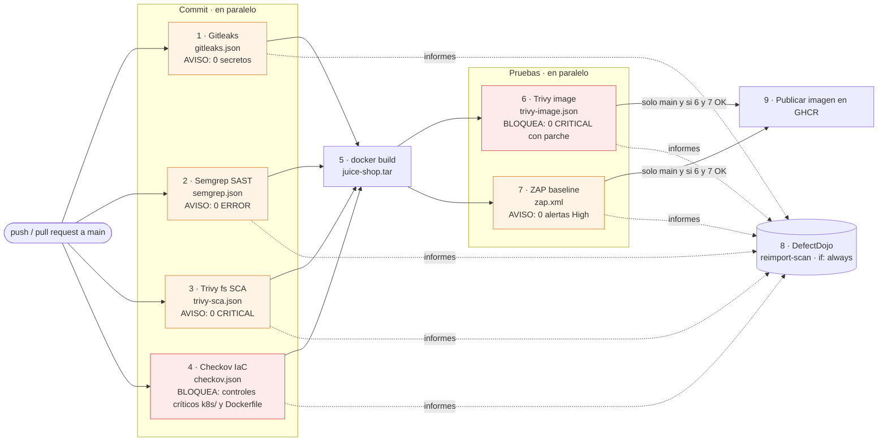
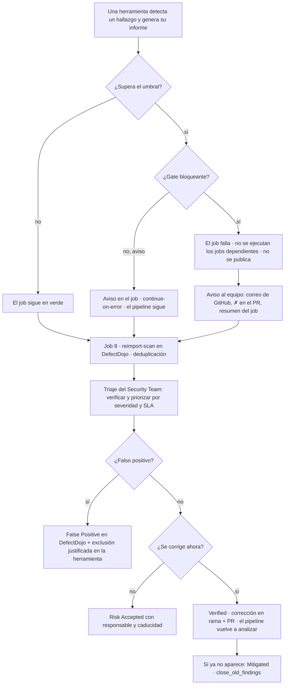

# Diagramas del pipeline (objetivo 1)

Las imágenes `1a-pipeline.png` y `1b-flujo-vulnerabilidad.png` son las versiones para el informe.
Abajo están las mismas ideas en Mermaid: GitHub las dibuja directamente al abrir este fichero.

## 1.a · Pipeline DevSecOps

## 1.b · Flujo ante una vulnerabilidad

